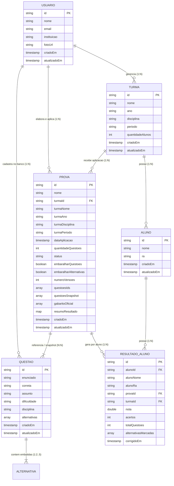

# Modelagem do Banco de Dados Cloud Firestore — Prova Certa (AvaliaPro)

Este documento descreve a modelagem oficial, arquitetura de dados, dicionário de campos, regras de segurança, índices e estratégias de persistência no **Cloud Firestore** para o aplicativo **Prova Certa** (AvaliaPro).

---

## 1. Visão Geral da Arquitetura

O **Prova Certa** é uma solução para apoio pedagógico a professores, permitindo a gestão de turmas, banco de questões, criação de provas e correção automatizada de folhas de resposta por visão computacional e QR Code.

### 1.1 Isolamento Multi-tenant por Usuário Autenticado
No Cloud Firestore, todos os dados acadêmicos e pedagógicos pertencem a um professor autenticado (`usuarioId`), identificado de forma unívoca pelo `UID` do **Firebase Authentication**.

Para assegurar isolamento rigoroso entre professores, segurança estrita por regras declarativas e facilidade de gestão de ciclo de vida de dados (inclusive conformidade com a LGPD), adotamos a arquitetura de **subcoleções sob o documento do usuário**:

```
usuarios/{usuarioId}
  │
  ├── turmas/{turmaId}
  │     │
  │     └── alunos/{alunoId}
  │
  ├── questoes/{questaoId}
  │     (alternativas embutidas)
  │
  └── provas/{provaId}
        │
        └── resultados/{alunoId}
```

---

## 2. Diagrama Entidade-Relacionamento (ER)



---

## 3. Especificação Detalhada das 7 Entidades

### 3.1 Entidade 1: Usuários (`Usuario`)
- **Caminho no Firestore**: `/usuarios/{usuarioId}`
- **ID do Documento**: `usuarioId` (igual ao `request.auth.uid` do Firebase Authentication).
- **Descrição**: Perfil do professor cadastrado na plataforma.

| Campo | Tipo Firestore | Obrigatório | Descrição / Validação |
| :--- | :--- | :--- | :--- |
| `nome` | `string` | Sim | Nome completo do professor (ex: "Ana Paula Santos"). |
| `email` | `string` | Sim | E-mail institucional ou pessoal do usuário. |
| `instituicao` | `string` | Sim | Escola ou faculdade onde o professor atua. |
| `fotoUrl` | `string` | Não | URL da foto de perfil ou avatar (opcional / nulo). |
| `criadoEm` | `timestamp` | Sim | Data e hora de criação do perfil no sistema. |
| `atualizadoEm` | `timestamp` | Sim | Data e hora da última modificação. |

> **Nota de Segurança**: Nenhuma senha ou informação de credencial é salva no Firestore. Toda autenticação, fluxo de login e redefinição de senha é processada nativamente pelo Firebase Authentication.

#### Exemplo de Documento: `/usuarios/usr_anapaula_2026`
```json
{
  "nome": "Ana Paula Santos",
  "email": "ana.santos@escola.edu.br",
  "instituicao": "E.E. Prof. Antônio Lemos",
  "fotoUrl": null,
  "criadoEm": "2026-03-01T11:00:00Z",
  "atualizadoEm": "2026-03-01T11:00:00Z"
}
```

---

### 3.2 Entidade 2: Turmas (`Turma`)
- **Caminho no Firestore**: `/usuarios/{usuarioId}/turmas/{turmaId}`
- **ID do Documento**: `turmaId` (gerado automaticamente ou UUID).
- **Descrição**: Turma ou classe sob responsabilidade do professor.

| Campo | Tipo Firestore | Obrigatório | Descrição / Validação |
| :--- | :--- | :--- | :--- |
| `nome` | `string` | Sim | Identificação da turma (ex: "1º A", "2º B"). |
| `ano` | `string` | Sim | Série ou ano letivo (ex: "1º Ano", "2º Ano"). |
| `disciplina` | `string` | Sim | Matéria ministrada na turma (ex: "Biologia", "Matemática"). |
| `periodo` | `string` | Sim | Turno das aulas: `"Manhã"`, `"Tarde"` ou `"Noite"`. |
| `quantidadeAlunos` | `integer` | Sim | Contador denormalizado de alunos matriculados na turma. |
| `criadoEm` | `timestamp` | Sim | Timestamp de criação da turma. |
| `atualizadoEm` | `timestamp` | Sim | Timestamp de atualização da turma. |

> **Decisão de Arquitetura**: A lista de alunos **NÃO é gravada dentro do documento da turma**. Os alunos residem na subcoleção `/alunos`. O documento da turma mantém apenas o contador numérico `quantidadeAlunos`, garantindo que a listagem de turmas na tela principal seja ultra-rápida e não ultrapasse o limite de 1 MB por documento.

#### Exemplo de Documento: `/usuarios/usr_anapaula_2026/turmas/turma_1a_2026`
```json
{
  "nome": "1º A",
  "ano": "1º Ano",
  "disciplina": "Biologia",
  "periodo": "Manhã",
  "quantidadeAlunos": 38,
  "criadoEm": "2026-03-02T13:30:00Z",
  "atualizadoEm": "2026-03-02T13:30:00Z"
}
```

---

### 3.3 Entidade 3: Alunos (`Aluno`)
- **Caminho no Firestore**: `/usuarios/{usuarioId}/turmas/{turmaId}/alunos/{alunoId}`
- **ID do Documento**: `alunoId` (gerado automaticamente ou correspondente à matrícula).
- **Descrição**: Aluno matriculado em uma turma específica.

| Campo | Tipo Firestore | Obrigatório | Descrição / Validação |
| :--- | :--- | :--- | :--- |
| `nome` | `string` | Sim | Nome completo do estudante (ex: "Ana Silva"). |
| `ra` | `string` | Sim | Registro Acadêmico / Matrícula. **Armazenado estritamente como String** para preservar zeros à esquerda (ex: `"024579"`). |
| `criadoEm` | `timestamp` | Sim | Timestamp de cadastro ou importação do aluno. |
| `atualizadoEm` | `timestamp` | Sim | Timestamp da última atualização cadastral. |

#### Exemplo de Documento: `/usuarios/usr_anapaula_2026/turmas/turma_1a_2026/alunos/aluno_323245`
```json
{
  "nome": "Ana Beatriz Ferreira",
  "ra": "024579",
  "criadoEm": "2026-03-02T14:00:00Z",
  "atualizadoEm": "2026-03-02T14:00:00Z"
}
```

---

### 3.4 Entidade 4: Questões (`Questao`)
- **Caminho no Firestore**: `/usuarios/{usuarioId}/questoes/{questaoId}`
- **ID do Documento**: `questaoId` (chave estável).
- **Descrição**: Questão de múltipla escolha cadastrada no banco pessoal do professor.

| Campo | Tipo Firestore | Obrigatório | Descrição / Validação |
| :--- | :--- | :--- | :--- |
| `enunciado` | `string` | Sim | Texto do enunciado da questão. |
| `correta` | `string` | Sim | Letra identificadora da alternativa correta (ex: `"A"`, `"B"`, `"C"`, `"D"` ou `"E"`). |
| `assunto` | `string` | Sim | Tópico abordado (ex: "Citologia", "Genética", "Ecologia"). |
| `dificuldade` | `string` | Sim | Nível de complexidade: `"Fácil"`, `"Média"` ou `"Difícil"`. |
| `disciplina` | `string` | Sim | Matéria da questão (ex: "Biologia"). |
| `alternativas` | `array<map>` | Sim | Lista ordenada com de 2 a 5 alternativas embutidas. |
| `criadoEm` | `timestamp` | Sim | Timestamp de inclusão no banco de questões. |
| `atualizadoEm` | `timestamp` | Sim | Timestamp da última edição da questão. |

#### Exemplo de Documento: `/usuarios/usr_anapaula_2026/questoes/q_citologia_01`
```json
{
  "enunciado": "Qual organela é responsável pela produção de energia (ATP) nas células eucarióticas?",
  "correta": "C",
  "assunto": "Citologia",
  "dificuldade": "Fácil",
  "disciplina": "Biologia",
  "alternativas": [
    { "letra": "A", "texto": "Ribossomo" },
    { "letra": "B", "texto": "Complexo de Golgi" },
    { "letra": "C", "texto": "Mitocôndria" },
    { "letra": "D", "texto": "Lisossomo" },
    { "letra": "E", "texto": "Retículo endoplasmático liso" }
  ],
  "criadoEm": "2026-03-05T09:15:00Z",
  "atualizadoEm": "2026-03-05T09:15:00Z"
}
```

---

### 3.5 Entidade 5: Alternativas (`Alternativa`)
- **Caminho no Firestore**: Embutidas no array `alternativas` dentro do documento da `Questao`.
- **Descrição**: Opção de resposta associada à questão.

| Campo | Tipo Firestore | Obrigatório | Descrição / Validação |
| :--- | :--- | :--- | :--- |
| `letra` | `string` | Sim | Identificador alfabético da alternativa: `"A"`, `"B"`, `"C"`, `"D"` ou `"E"`. |
| `texto` | `string` | Sim | Conteúdo descritivo da alternativa. |

> **Decisão de Arquitetura (Embedded vs Subcoleção)**: Cada questão possui no máximo 5 alternativas curtas (~100 a 200 bytes no total). Separar alternativas em uma subcoleção aumentaria o custo de leitura em 5x (5 documentos lidos para cada questão exibida na listagem ou na prova). O embedding em lista de mapas é a abordagem canônica e de maior eficiência de custo no Cloud Firestore.

---

### 3.6 Entidade 6: Provas (`Prova`)
- **Caminho no Firestore**: `/usuarios/{usuarioId}/provas/{provaId}`
- **ID do Documento**: `provaId`.
- **Descrição**: Avaliação configurada pelo professor para ser aplicada a uma turma.

| Campo | Tipo Firestore | Obrigatório | Descrição / Validação |
| :--- | :--- | :--- | :--- |
| `nome` | `string` | Sim | Título da prova (ex: "1ª Prova Bimestral — Citologia"). |
| `turmaId` | `string` | Sim | ID da turma destinatária da avaliação. |
| `turmaNome` | `string` | Sim | Nome da turma desnormalizado (ex: "1º A"). |
| `turmaAno` | `string` | Sim | Ano da turma desnormalizado (ex: "1º Ano"). |
| `turmaDisciplina` | `string` | Sim | Disciplina da turma desnormalizada. |
| `turmaPeriodo` | `string` | Sim | Turno da turma desnormalizado (ex: "Manhã"). |
| `dataAplicacao` | `timestamp` | Sim | Data agendada para a aplicação da prova. |
| `quantidadeQuestoes`| `integer` | Sim | Quantidade de questões (ex: 5, 10, 15, 20). |
| `status` | `string` | Sim | Estado da prova: `"rascunho"`, `"ativa"` ou `"encerrada"`. |
| `embaralharQuestoes`| `boolean` | Sim | Flag para ordenação aleatória de questões por folha. |
| `embaralharAlternativas`| `boolean` | Sim | Flag para ordenação aleatória de alternativas. |
| `numeroVersoes` | `integer` | Sim | Quantidade de gabaritos/versões gerados (mínimo 1). |
| `questoesIds` | `array<string>` | Sim | Lista ordenada com os IDs das questões utilizadas. |
| `questoesSnapshot` | `array<map>` | Sim | **Snapshot imutável** do conteúdo das questões e alternativas no momento de geração da prova. |
| `gabaritoOficial` | `array<string>` | Não | Letras corretas na ordem da prova (ex: `["C", "B", "B", "A", ...]`). |
| `resumoResultado` | `map` | Não | Resumo estatístico agregado gerado após a leitura das folhas. |
| `criadoEm` | `timestamp` | Sim | Timestamp de criação da prova. |
| `atualizadoEm` | `timestamp` | Sim | Timestamp da última atualização. |

> **Decisão de Arquitetura (Snapshot Imutável)**: Ao gerar as folhas de prova e o QR Code de gabarito, o aplicativo copia o snapshot completo das questões para o campo `questoesSnapshot`. Isso garante que, caso o professor altere ou remova uma questão do banco semanas depois, o histórico da avaliação aplicada permaneça 100% íntegro e reprodutível. Para provas padrão (10 a 50 questões), o snapshot ocupa ~15 KB, muito abaixo do teto de 1 MB por documento do Firestore.

#### Exemplo de Documento: `/usuarios/usr_anapaula_2026/provas/prova_citologia_bim1`
```json
{
  "nome": "1ª Prova Bimestral — Citologia",
  "turmaId": "turma_1a_2026",
  "turmaNome": "1º A",
  "turmaAno": "1º Ano",
  "turmaDisciplina": "Biologia",
  "turmaPeriodo": "Manhã",
  "dataAplicacao": "2026-08-15T11:00:00Z",
  "quantidadeQuestoes": 10,
  "status": "encerrada",
  "embaralharQuestoes": false,
  "embaralharAlternativas": false,
  "numeroVersoes": 1,
  "questoesIds": ["q_citologia_01", "q_citologia_02"],
  "questoesSnapshot": [
    {
      "enunciado": "Qual organela é responsável pela produção de energia (ATP) nas células eucarióticas?",
      "correta": "C",
      "assunto": "Citologia",
      "dificuldade": "Fácil",
      "disciplina": "Biologia",
      "alternativas": [
        { "letra": "A", "texto": "Ribossomo" },
        { "letra": "B", "texto": "Complexo de Golgi" },
        { "letra": "C", "texto": "Mitocôndria" },
        { "letra": "D", "texto": "Lisossomo" },
        { "letra": "E", "texto": "Retículo endoplasmático liso" }
      ]
    }
  ],
  "gabaritoOficial": ["C", "B", "B", "A", "D", "B", "A", "C", "A", "B"],
  "resumoResultado": {
    "media": 7.2,
    "minimo": 3.0,
    "maximo": 10.0,
    "totalFolhasCorrigidas": 5,
    "distribuicao": [
      { "faixa": "0-2", "quantidade": 0 },
      { "faixa": "2-4", "quantidade": 1 },
      { "faixa": "4-6", "quantidade": 0 },
      { "faixa": "6-8", "quantidade": 1 },
      { "faixa": "8-10", "quantidade": 3 }
    ],
    "porQuestao": [
      {
        "numero": 1,
        "alternativaCorreta": "C",
        "percentualAcerto": 80.0,
        "alternativas": [
          { "letra": "A", "quantidade": 0, "percentual": 0.0, "correta": false },
          { "letra": "B", "quantidade": 1, "percentual": 20.0, "correta": false },
          { "letra": "C", "quantidade": 4, "percentual": 80.0, "correta": true },
          { "letra": "D", "quantidade": 0, "percentual": 0.0, "correta": false },
          { "letra": "E", "quantidade": 0, "percentual": 0.0, "correta": false }
        ]
      }
    ]
  },
  "criadoEm": "2026-08-01T10:00:00Z",
  "atualizadoEm": "2026-08-15T18:00:00Z"
}
```

---

### 3.7 Entidade 7: Resultados (`ResultadoAluno` e `ResultadoProva`)
Os resultados combinam dois níveis de persistência para aliar granularidade analítica e alto desempenho:

#### A. Resultado Individual por Aluno (`ResultadoAluno`)
- **Caminho no Firestore**: `/usuarios/{usuarioId}/provas/{provaId}/resultados/{alunoId}`
- **ID do Documento**: `alunoId` (garante idempotência na leitura das folhas).
- **Descrição**: Registro detalhado da folha de resposta corrigida para um aluno.

| Campo | Tipo Firestore | Obrigatório | Descrição / Validação |
| :--- | :--- | :--- | :--- |
| `alunoId` | `string` | Sim | ID único do aluno. |
| `alunoNome` | `string` | Sim | Nome completo do aluno no momento da correção. |
| `alunoRa` | `string` | Sim | RA / Matrícula com zeros à esquerda preservados como String. |
| `nota` | `number` | Sim | Nota obtida (ex: 8.5, 10.0). |
| `acertos` | `integer` | Sim | Total de questões respondidas corretamente (ex: 8). |
| `totalQuestoes` | `integer` | Sim | Total de questões avaliadas (ex: 10). |
| `alternativasMarcadas` | `array<string>` | Sim | Lista com as letras detectadas pelo leitor óptico (ex: `["A", "B", "C", ...]`). |
| `provaId` | `string` | Não | ID da prova de referência. |
| `turmaId` | `string` | Não | ID da turma de referência. |
| `corrigidoEm` | `timestamp` | Sim | Timestamp em que a folha foi lida pela câmera. |

#### Exemplo de Documento: `/usuarios/usr_anapaula_2026/provas/prova_citologia_bim1/resultados/aluno_323245`
```json
{
  "alunoId": "aluno_323245",
  "alunoNome": "Ana Beatriz Ferreira",
  "alunoRa": "024579",
  "nota": 10.0,
  "acertos": 10,
  "totalQuestoes": 10,
  "alternativasMarcadas": ["C", "B", "B", "A", "D", "B", "A", "C", "A", "B"],
  "provaId": "prova_citologia_bim1",
  "turmaId": "turma_1a_2026",
  "corrigidoEm": "2026-08-15T15:30:00Z"
}
```

#### B. Resumo Estatístico Agregado (`ResultadoProva`)
- **Armazenamento**: Embutido no campo `resumoResultado` do documento da prova (`/provas/{provaId}`).
- **Conteúdo**:
  - `media`: Média geral da turma.
  - `minimo`: Menor nota registrada.
  - `maximo`: Maior nota registrada.
  - `totalFolhasCorrigidas`: Quantidade de folhas processadas.
  - `distribuicao`: Distribuição em 5 faixas (0-2, 2-4, 4-6, 6-8, 8-10).
  - `porQuestao`: Taxa de acerto e distribuição de escolhas por alternativa para cada questão.

---

## 4. Decisões Técnicas e Justificativas de Arquitetura

### 4.1 Estratégia de Manutenção do Contador `quantidadeAlunos`
Como o Firestore cobra por leitura e cada consulta a uma coleção traz todos os documentos filtrados, efetuar um `collection.count()` ou carregar todos os alunos da turma para exibir a lista de turmas seria ineficiente.
- O campo `Turma.quantidadeAlunos` é mantido como contador denormalizado.
- **Inserção/Remoção Individual**: Utiliza `FieldValue.increment(1)` ou `FieldValue.increment(-1)` na mesma transação que cria/deleta o documento em `/alunos`.
- **Importação em Lote (Excel/CSV)**: Ao importar uma planilha com $N$ alunos, um `WriteBatch` grava os novos documentos de alunos e aplica uma única operação `FieldValue.increment(N)` no documento da turma.

### 4.2 Consistência e Atualização dos Resumos Agregados de Prova
Quando o leitor óptico finaliza uma sessão de correção de folhas:
1. Uma **Transação do Firestore** (ou Cloud Function disparada em `onWrite` de `/resultados/{alunoId}`) calcula a nova média, mínimo, máximo e distribuição.
2. A atualização do documento da prova é atômica, evitando condições de corrida (*race conditions*) caso o professor corrija múltiplas folhas em sequência.

### 4.3 Exclusão de Documentos Pais e Tratamento de Subcoleções (Sem Cascading Delete)
O Cloud Firestore **não realiza exclusão em cascata automática**. Se o documento `/turmas/{turmaId}` for deletado, os documentos em `/turmas/{turmaId}/alunos/{alunoId}` continuariam existindo como documentos órfãos.
- **Estratégia Recomendada para o Prova Certa**:
  1. **Exclusão Transacional pelo Cliente**: Antes de deletar a turma ou a prova, o aplicativo busca os documentos das subcoleções em lotes de 500 e executa a exclusão via `WriteBatch`.
  2. **Soft Delete**: Adição opcional do campo `ativo: false` ou `deletadoEm: timestamp`, permitindo recuperação de dados e limpeza assíncrona periódica.
  3. **Cloud Function de Limpeza**: Uma função `onDelete` em background que invoca o `firebase-tools.firestore.delete()` recursivo no servidor.

### 4.4 Ausência de Senhas no Firestore
Nenhum campo relativo a credenciais, senhas, PINs ou hashes é persistido no Firestore. As regras declarativas de segurança bloqueiam qualquer tentativa de escrita de chaves como `senha`, `password` ou `hash`.

---

## 5. Regras de Segurança do Firestore (`firestore.rules`)

As regras estão implementadas na raiz do projeto em `firestore.rules`. Elas asseguram:
1. **Negação por Padrão**: Toda rota não declarada é sumariamente bloqueada (`allow read, write: if false;`).
2. **Propriedade Estrita (Isolamento de Tenant)**: Apenas o professor cujo `request.auth.uid == userId` pode ler, criar, editar ou excluir documentos sob sua árvore `/usuarios/{userId}`.
3. **Validação Rigorosa de Schema e Tipos**:
   - `keys().hasOnly(...)` impede injeção de campos desconhecidos.
   - Tipos de dados validados (`string`, `int`, `number`, `list`, `bool`).
   - `status in ['rascunho', 'ativa', 'encerrada']` para provas.
   - `alternativas.size() >= 2 && alternativas.size() <= 5` para questões.
   - Proibição de inclusão do array `alunos` no documento da turma.

---

## 6. Índices Compostos (`firestore.indexes.json`)

Configurados no arquivo `firestore.indexes.json` para suportar consultas complexas:

1. **`provas`**: Filtro por status e ordenação por data de aplicação descendente.
   - Campos: `status` (ASC), `dataAplicacao` (DESC).
2. **`provas`**: Filtro por turma e ordenação por data de aplicação descendente.
   - Campos: `turmaId` (ASC), `dataAplicacao` (DESC).
3. **`questoes`**: Filtro composto por disciplina, dificuldade e ordenação por data de criação.
   - Campos: `disciplina` (ASC), `dificuldade` (ASC), `criadoEm` (DESC).
4. **`questoes`**: Filtro por assunto e ordenação por data de criação.
   - Campos: `assunto` (ASC), `criadoEm` (DESC).
5. **`resultados`**: Ordenação por nota e ordenação alfabética por nome de aluno.
   - Campos: `nota` (DESC), `alunoNome` (ASC).

---

## 7. Guia de Configuração no Firebase Console

Para o funcionamento completo da persistência em ambiente de produção ou homologação:

1. **Criar / Acessar o Projeto no Firebase Console**:
   - Acesse [console.firebase.google.com](https://console.firebase.google.com).
   - Crie um novo projeto ou selecione o projeto existente do **Prova Certa**.

2. **Ativar o Firebase Authentication**:
   - No menu lateral esquerdo, clique em **Build > Authentication**.
   - Clique em **Get Started** (Primeiros passos).
   - Na aba **Sign-in method**, selecione **Email/Password** e ative a opção **Email/Password**.

3. **Criar o Banco de Dados Cloud Firestore**:
   - No menu lateral, acesse **Build > Firestore Database**.
   - Clique em **Create database**.
   - Selecione o **Production mode** (as regras de `firestore.rules` controlarão os acessos).
   - Escolha a região mais próxima dos usuários (ex: `southamerica-east1` - São Paulo).

4. **Publicar Regras de Segurança e Índices via Firebase CLI**:
   - No terminal, com o Firebase CLI instalado, execute:
     ```bash
     firebase login
     firebase use --add [SEU-PROJECT-ID]
     firebase deploy --only firestore
     ```
   - O comando fará o upload simultâneo de `firestore.rules` e `firestore.indexes.json`.

5. **Alternativa Manual pelo Navegador**:
   - Caso prefira não usar o CLI:
     - Copie o conteúdo de `firestore.rules` e cole na aba **Rules** da seção Firestore no Console, clicando em **Publish**.
     - Copie as definições de `firestore.indexes.json` e adicione manualmente na aba **Indexes**.
