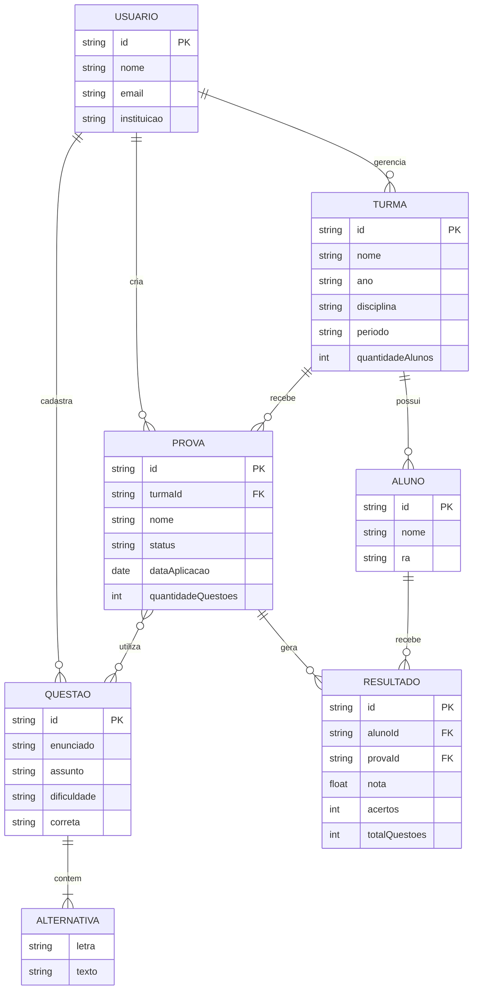

# Modelagem do Banco de Dados — Prova Certa

O Prova Certa utiliza o Cloud Firestore, um banco de dados NoSQL do Firebase.

Os dados são organizados por professor, utilizando o UID do Firebase Authentication como identificador.

## Diagrama de Entidades e Relacionamentos



## Organização dos dados

- **Usuários:** informações dos professores.
- **Turmas:** turmas cadastradas por cada professor.
- **Alunos:** estudantes vinculados às turmas.
- **Questões:** questões cadastradas pelo professor.
- **Alternativas:** opções de resposta armazenadas nas questões.
- **Provas:** avaliações associadas às turmas.
- **Resultados:** desempenho dos alunos nas avaliações.

## Estrutura no Firestore

```text
usuarios/{usuarioId}
  ├── turmas/{turmaId}
  │   └── alunos/{alunoId}
  ├── questoes/{questaoId}
  └── provas/{provaId}
      └── resultados/{alunoId}
```

As alternativas são armazenadas diretamente nos documentos das questões, enquanto provas e resultados mantêm as referências necessárias às turmas e aos alunos.

O diagrama representa os relacionamentos conceituais, pois o Firestore não utiliza chaves estrangeiras como um banco relacional.
